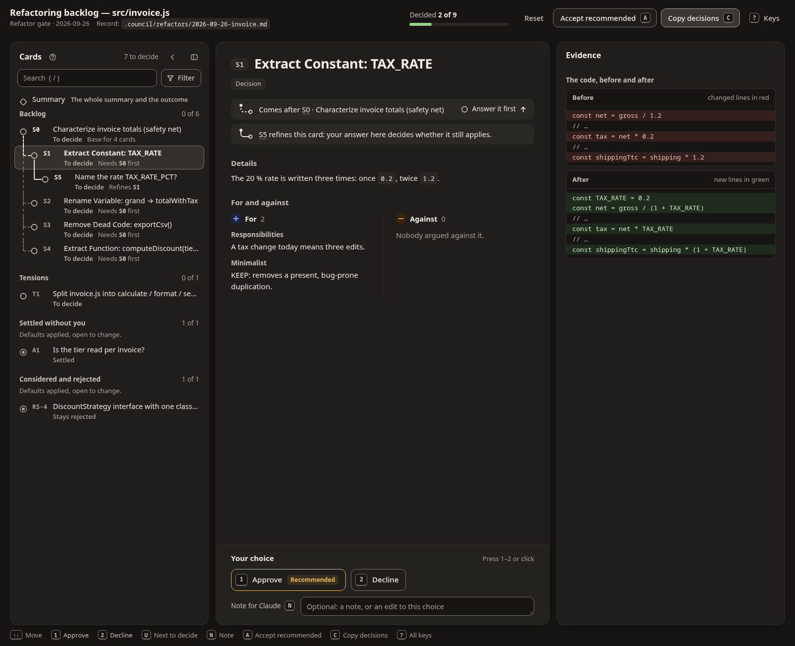
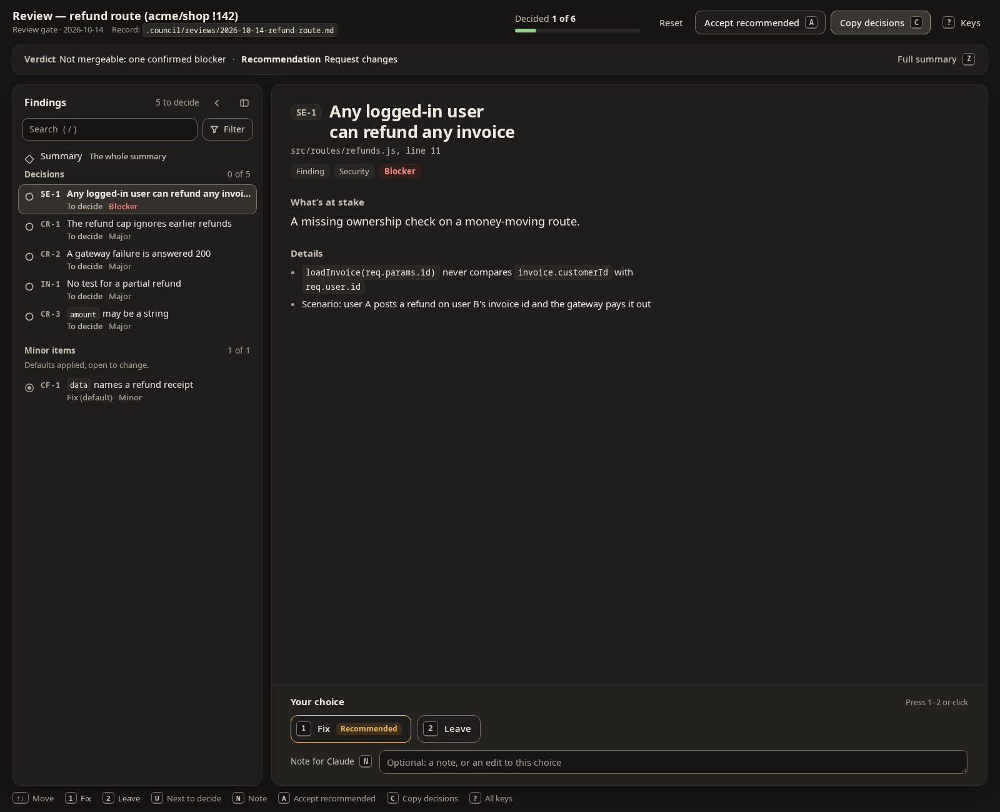
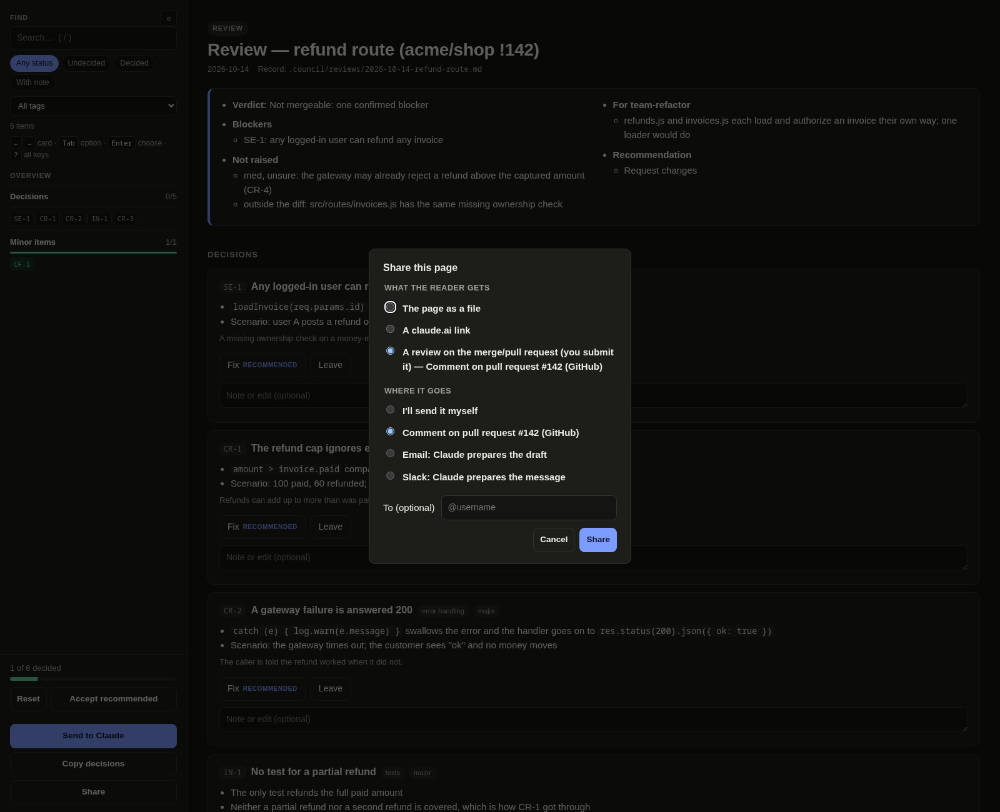

# team-skills

**Agent-team skills for [Claude Code](https://claude.com/claude-code).** Instead of one model giving one opinion, these skills dispatch a *team* of agents, each in its own isolated context. The agents debate with evidence, a gate kills speculative work, and **you, the CEO, make the final call** on a local HTML decision page. A review can be handed on from there: the owner of the branch you reviewed gets a page to decide on alone.



## The skills

| Skill | What it does |
|-------|--------------|
| [`team-scan`](skills/team-scan/SKILL.md) | Profiles a project (stack, conventions, skills, agents, decision records, other model CLIs) into `.council/project-profile.md`, which every other skill reads. |
| [`team-council`](skills/team-council/SKILL.md) | Before the code exists: **PO, CTO, UX, Philosopher and Wildcard**, each a lens with its own sources, debate a decision. The roster and the rounds fit the decision. A PO synthesis gives consensus, tensions and a recommendation, and the decision is recorded. |
| [`team-council-plan`](skills/team-council-plan/SKILL.md) | Turns a recorded decision into an implementation plan, reviewed by the CTO, PO and UX roles before you approve it. |
| [`team-kickoff`](skills/team-kickoff/SKILL.md) | Bootstraps a brand-new project: vision → scan → council → project brief → initial profile and `CLAUDE.md`. |
| [`team-refactor`](skills/team-refactor/SKILL.md) | **Responsibilities, Mechanics, Sequencing, Safety Net and Depth** review scoped code blind for its structure, and a **Minimalist** KISS/YAGNI gate kills speculative abstractions. You approve the backlog; it then runs one behavior-preserving step per commit behind characterization tests. Suspected bugs go to `team-review`. |
| [`team-review`](skills/team-review/SKILL.md) | **Correctness, Security, Intent and Craft** review a diff or a module blind, and a **Verifier** tries to refute every finding before it is raised. You curate the few that survive, then share them as a review on the merge/pull request, or have them fixed test-first. |
| [`team-ceo-view`](skills/team-ceo-view/SKILL.md) | Renders any gate as one HTML page: where the work lands beside today's state, then one card per decision with its arguments, metrics, code diff and figures (drawing guide adapted from [diagram-design](https://github.com/cathrynlavery/diagram-design)). **Send to Claude** hands your decisions back to the session. **Share**, on review gates only, turns the gate into a page for the owner of the branch you reviewed: they decide alone, starting from your choices, and copy a prompt for their own coding agent. Share asks what they get (the file, a claude.ai link, or a review on the merge/pull request that you submit) and where it goes (you send it, a merge/pull request comment, a prepared email or Slack message). |
| [`team-protocol`](skills/team-protocol/SKILL.md) | The shared rules: dispatch, the agent contract, counting positions, the handoff. The other skills load it. |

## Which skill?



| Skill | Question | When |
|-------|----------|------|
| `team-council` | Which way do we go? | Before the code exists |
| `team-council-plan` | How do we carry out the decision? | After a council decision, before the code |
| `team-refactor` | Is this code shaped for the next change? | Code exists; fixes preserve behavior |
| `team-review` | Can this change merge as is? | Code exists; fixes change behavior |

The fix decides the lane. A fix that changes behavior (a bug, a hole, a swallowed error, a missing test) is `team-review`'s; a named, behavior-preserving refactoring is `team-refactor`'s. Each skill hunts only in its lane; what an agent stumbles on in the other one goes to a short hand-off list (*For team-review*, *For team-refactor*), unverified and without a decision.

## How they fit together

![team-scan writes the project profile that team-council, team-refactor and team-review read. team-kickoff runs team-scan, then team-council, and team-council's decision feeds team-council-plan. team-refactor and team-review hand each other work in both directions: suspected bugs go to review, structure goes to refactor. team-council-plan offers team-review after its plan is executed. All five skills run under team-protocol's shared rules, and each ends at a CEO gate rendered by team-ceo-view, where you decide; only team-review's gate has Share, to the branch owner.](docs/how-they-fit.svg)

Everything a run produces is plain Markdown under `.council/` in your project, so it can be committed and diffed:

```
.council/
├── project-profile.md          # team-scan
├── decisions/YYYY-MM-DD-*.md   # team-council, team-kickoff
├── refactors/YYYY-MM-DD-*.md   # team-refactor: the record
│   └── *.exec.md               # the executor's brief, deleted after execution
├── reviews/YYYY-MM-DD-*.md     # team-review: the record
│   └── *.exec.md               # the executors' brief, own branch or audit; deleted after execution, like the refactor one
├── runs/<run>/                 # agent outputs during a run, deleted at its gate
├── gates/*.ceo.json → *.html   # team-ceo-view (regenerable), + *.decisions.txt, *.share.html (review gates)
└── role-overrides/role-*.md    # optional: override any role per project
```

## Design principles

- **Separation of context.** Each role is its own agent. One context playing six roles is one opinion in six costumes.
- **Evidence, counted.** Every claim cites code, docs or a skill, credited to its role. The roles share one model, so only positions with checkable evidence count toward a majority. With your yes, the Philosopher can sit on another vendor's model.
- **Tensions surfaced, not smoothed.** A majority goes in the backlog with its dissent; a conflict with no majority goes to you.
- **The human decides.** Agents recommend; the CEO gate decides; Markdown stays the source of truth.
- **Refuted before raised.** A finding reaches you only after an agent other than its author tried to prove it wrong. A review that cries wolf gets ignored.
- **KISS/YAGNI has teeth.** An abstraction needs a second use case that exists today. The Minimalist's KILL is a gate, not a vote.
- **Token economy.** Cost is context size × turns. Agents run on Sonnet with a tool budget and write to files; writer agents build pages, records and plans; each gate hands off to a fresh session through a short file.

## Install

### As a Claude Code plugin

```
/plugin marketplace add TokiDEV/team-skills
/plugin install team-skills@team-skills
```

### Manually

```bash
git clone https://github.com/TokiDEV/team-skills.git
cp -r team-skills/skills/team-* ~/.claude/skills/
# or symlink them, so a git pull updates them:
for d in team-skills/skills/team-*; do ln -s "$PWD/$d" ~/.claude/skills/; done
```

Use one method or the other, not both, or every skill will show up twice.

**Requirements:** Claude Code with subagent support. `team-ceo-view` needs Node.js to render and serve its page. `team-scan` maps whatever skills, agents and MCP servers you have to the roles, so the council works without companions, and uses them when they're installed: for example [superpowers](https://github.com/obra/superpowers) (TDD, planning, plan execution) and [impeccable](https://impeccable.style) (UX audits).

## Usage

Ask in plain language; the skills trigger on intent:

> *"Scan this project for the council."*
> *"Run the council: should we move from REST to tRPC?"*
> *"Plan the council's decision."*
> *"Refactor src/billing — it's a god function nobody wants to touch."*
> *"Review !142 before I approve it."*
> *"Review my branch before I open the MR."*
> *"Audit src/auth for security."*

Or invoke one directly: `/team-refactor src/billing/invoice.js` after a manual install, or `/team-skills:team-refactor …` after a plugin install.

Add `auto-accept` to skip the page at every gate of that run: each recommendation is taken, and Claude asks in chat only about what has none, what relies on a declined item, and what corrects something you said. The record says it was auto-accepted. It lasts one run, and never applies to a review you share with a branch owner.

## Try the CEO view

[`examples/refactor-gate/`](examples/refactor-gate) holds a sample gate JSON and the page rendered from it. Download `invoice.html` and open it in a browser, or re-render it:

```bash
node skills/team-ceo-view/render.js examples/refactor-gate/invoice.ceo.json
# or serve it, as the skills do: Send to Claude prints the decisions, exits and closes the tab
node skills/team-ceo-view/render.js examples/refactor-gate/invoice.ceo.json --serve
# or auto-accept it: no page, the block of recommended choices is printed and saved to invoice.decisions.txt
node skills/team-ceo-view/render.js examples/refactor-gate/invoice.ceo.json --accept-recommended
```

[`examples/review-gate/`](examples/review-gate) holds a review gate: `refund.ceo.json`, its page, and what Share makes from it. Share is for review gates, where the branch owner decides alone, starting from your choices, with **Copy prompt** in place of Send: a standalone file, or `--artifact` for a claude.ai Artifact.



```bash
node skills/team-ceo-view/render.js examples/review-gate/refund.ceo.json --share --preset=examples/review-gate/refund.share.txt
```

Or hand it over as a pending review on the pull request, which you submit yourself (`--diff` checks that every comment lands on a line of the diff):

```bash
node skills/team-ceo-view/render.js examples/review-gate/refund.ceo.json --share --preset=examples/review-gate/refund.share.txt --review=github --head=<sha> --diff=examples/review-gate/refund.diff
```

Keyboard: `←`/`→` move between cards (a folded group opens as you reach it), `Tab` cycles the options, `Enter` chooses, `u` jumps to the next undecided card, and `?` lists every shortcut.

## Status

Personal skills, shared as-is. Exercised on live runs:

- ✅ `team-refactor` end to end on two TypeScript projects, PR-scoped and repo-wide, Step Batches included
- ✅ `team-council` on an architecture decision and a product decision: framing interview, fitted roster, counted positions
- ✅ `team-council-plan` from the product decision, including an amendment at the plan gate and a partial re-gate
- ✅ `team-scan`, and `team-ceo-view` with the `--serve` round trip (pages of up to 51 decisions)
- ✅ Token economy: a refactor run went from about 104M tokens to 16M (different scopes), the orchestrator from about 60% of the cost to 26%
- ⚠️ 0.7.0 adds team-review, and sharing a review gate with the branch owner (Share button, --share, a pending review on the MR/PR); not yet run live
- ⚠️ 0.8.0 adds per-run `auto-accept` (`--accept-recommended`); not yet run live
- ⚠️ 0.6.0 fixes what the last runs found, not yet re-run live: permission prompts on role files, steps naming two refactorings, environment facts missed at framing, plan rework from sub-plans written in parallel
- ⚠️ Not yet live: `team-kickoff`'s interview, an off-model seat, record supersession
- ⚠️ In a `.bare/` worktree, add the git directory to the sandbox's write paths, or executors can't commit

Issues and PRs are welcome.

## License

[MIT](LICENSE)
