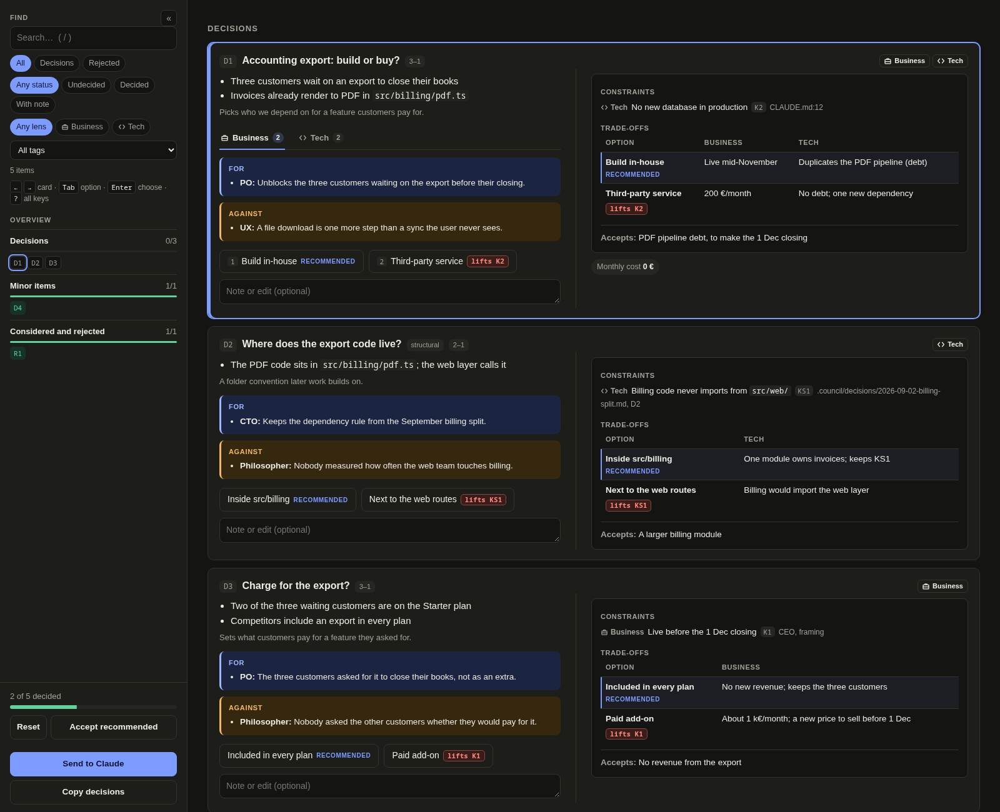

# team-skills

**Agent-team skills for [Claude Code](https://claude.com/claude-code).** Instead of one model giving one opinion, these skills dispatch a *team* of agents, each in its own isolated context. The agents debate with evidence, a gate kills speculative work, and **you, the CEO, make the final call** on a local HTML decision page. A review can be handed on from there: the owner of the branch you reviewed gets a page to decide on alone.


## The skills

| Skill | What it does |
|-------|--------------|
| [`team-scan`](skills/team-scan/SKILL.md) | Project → `.council/project-profile.md` (stack, conventions, tools, expected load, limits). Read by every skill. |
| [`team-council`](skills/team-council/SKILL.md) | Decision before code. **PO, CTO, UX, Philosopher, Wildcard** debate; PO synthesis; decision recorded. |
| [`team-council-plan`](skills/team-council-plan/SKILL.md) | Decision → implementation plan, reviewed by CTO, PO, UX. |
| [`team-kickoff`](skills/team-kickoff/SKILL.md) | New project: vision → scan → council → brief, profile, `CLAUDE.md`. |
| [`team-refactor`](skills/team-refactor/SKILL.md) | Structure review by 5 blind lenses, **Minimalist** gate. One behavior-preserving step per commit, behind characterization tests. |
| [`team-review`](skills/team-review/SKILL.md) | Diff or module review by 4 blind lenses; a **Verifier** refutes each finding. Output: a forge review or test-first fixes. |
| [`team-ceo-view`](skills/team-ceo-view/SKILL.md) | Gate → one HTML page: a three-pane console: the list of cards with rails for what refines or follows what, the current card (arguments tagged Business or Tech, your choice), and its evidence (trade-offs, numbers, diff, figures after [diagram-design](https://github.com/cathrynlavery/diagram-design)); what agents settled alone, reopenable. **Send to Claude** returns your answers; **Share** (reviews) hands the gate to the branch owner. |
| [`team-protocol`](skills/team-protocol/SKILL.md) | Shared rules every skill loads: dispatch, agent contract, bridge, scope, handoff, execution. |

## Which skill?


| Skill | Question | When |
|-------|----------|------|
| `team-council` | Which way do we go? | Before the code exists |
| `team-council-plan` | How do we carry out the decision? | After a council decision, before the code |
| `team-refactor` | Is this code shaped for the next change? | Code exists; fixes preserve behavior |
| `team-review` | Can this change merge as is? | Code exists; fixes change behavior |

The fix decides the lane ([the full rule](skills/team-review/SKILL.md#lanes)). A fix that changes behavior (a bug, a hole, a swallowed error, a missing test for new or changed behavior, a gap with the request, a slow path) is `team-review`'s; a named, behavior-preserving refactoring, and the characterization tests that pin unchanged behavior before it, are `team-refactor`'s. Each skill hunts only in its lane; what an agent stumbles on in the other one goes to a short hand-off list (*For team-review*, *For team-refactor*), unverified and without a decision, and the other skill takes the list in from the record: `/team-review <refactor record>` sends a refactor's suspected bugs straight to the verifier, and `/team-refactor <review record>` refactors what a review flagged. To review and refactor a whole branch, ask for a sweep: every zone is reviewed, and only the zones a review flags are refactored.

## How they fit together

![team-scan writes the project profile that team-council, team-refactor and team-review read. team-kickoff runs team-scan, then team-council, and team-council's decision feeds team-council-plan. team-refactor and team-review hand each other work in both directions, and each takes the other's list in from the record: suspected bugs go to a review intake, structure to a refactor intake. A sweep runs them in order: review, refactor where a review asks, then one intake review. team-council-plan offers team-review after its plan is executed. All five skills run under team-protocol's shared rules, and each ends at a CEO gate rendered by team-ceo-view, where you decide; only team-review's gate has Share, to the branch owner.](docs/how-they-fit.svg)

Everything a run produces is plain Markdown in your project, under `.council/` except the plan, so it can be committed and diffed:

```
.council/
├── project-profile.md          # team-scan
├── decisions/YYYY-MM-DD-*.md   # team-council; team-kickoff's project brief
├── refactors/YYYY-MM-DD-*.md   # team-refactor: the record
│   └── *.exec.md               # the executors' brief, deleted after execution
├── reviews/YYYY-MM-DD-*.md     # team-review: the record
│   └── *.exec.md               # the executors' brief, own branch or audit; deleted after execution
├── runs/<run>/                 # agent outputs during a run, deleted at its gate; execution gets a fresh one
├── gates/                      # team-ceo-view: each gate's JSON, page and what it leaves beside them (list: its SKILL.md, Gate artifacts)
└── role-overrides/role-*.md    # optional: override any role per project
docs/plans/YYYY-MM-DD-*.md      # team-council-plan: the plan (or your project's plan location)
```

## Design principles

- **Separation of context.** Each role is its own agent. One context playing six roles is one opinion in six costumes.
- **Evidence, counted.** Every claim cites code, docs or a skill, credited to its role. The roles share one model, so only positions with checkable evidence count toward a majority. With your yes, the Philosopher can sit on another vendor's model.
- **Tensions surfaced, not smoothed.** A majority goes in the backlog with its dissent; a conflict with no majority goes to you.
- **The human decides.** Agents recommend; the CEO gate decides, structure included (a new package, layer or dependency rule is never a writer's call); Markdown stays the source of truth.
- **Business and tech on one decision.** Every argument says which lens it belongs to. Each weighty card shows the constraints that bind it and what each option costs on each side, and the recommendation says what it accepts. Constraints and accepted trade-offs travel from the framing to the record, the plan and the profile; only you lift a constraint.
- **Refuted before raised.** A finding reaches you only after an agent other than its author tried to prove it wrong. A review that cries wolf gets ignored.
- **KISS/YAGNI has teeth.** An abstraction needs a second use case that exists today. The Minimalist's KILL is a gate, not a vote.
- **Token economy.** Cost is context size × turns. Agents run on Sonnet by default, and each skill's table names the few on Opus (e.g. the synthesis of a two-round debate, the verifier, final reviews). Each agent has a tool budget and writes to files; writer agents build pages, records and plans; each gate hands off to a fresh session through a short file.

## Install

### As a Claude Code plugin

```
/plugin marketplace add plasminds/team-skills
/plugin install team-skills@team-skills
```

### Manually

```bash
git clone https://github.com/plasminds/team-skills.git
cp -r team-skills/skills/team-* ~/.claude/skills/
# or symlink them, so a git pull updates them:
for d in team-skills/skills/team-*; do ln -s "$PWD/$d" ~/.claude/skills/; done
```

Use one method or the other, not both, or every skill will show up twice.

**Requirements:** Claude Code with subagent support. The skills copy their files into the run folder before anyone reads them. If a run still asks to read a skill file, allow reads of the install folder in your settings' `permissions.allow`: `Read(~/.claude/skills/**)` after a manual install (plus the clone's own path when you symlinked it, e.g. `Read(//home/you/team-skills/skills/**)`), or `Read(~/.claude/plugins/cache/**)` after a plugin install. `team-ceo-view` needs Node.js to render and serve its page. `team-scan` maps whatever skills, agents and MCP servers you have to the roles, so the council works without companions, and uses them when they're installed: for example [superpowers](https://github.com/obra/superpowers) (TDD, planning, plan execution) and [impeccable](https://impeccable.style) (UX audits).

**Sandbox and `.bare/` worktrees:** add the whole git directory to the sandbox's write paths. With only `worktrees/`, `objects/`, `refs/` and `logs/`, executors can commit, but rebase and cherry-pick fail on `packed-refs.lock`.

## Usage

Ask in plain language; the skills trigger on intent:

> *"Scan this project for the council."*
> *"Run the council: should we move from REST to tRPC?"*
> *"Plan the council's decision."*
> *"Refactor src/billing — it's a god function nobody wants to touch."*
> *"Review !142 before I approve it."*
> *"Review my branch before I open the MR."*
> *"Audit src/auth for security."*
> *"Sweep the phase-12 branch: review every zone, refactor only where it's needed."*

Or invoke one directly: `/team-refactor src/billing/invoice.js` after a manual install, or `/team-skills:team-refactor …` after a plugin install.

Add `auto-accept` to skip the page at every gate of that run: each recommendation is taken, and Claude asks in chat only about what has none, what relies on a declined item, and what corrects something you said. The record says it was auto-accepted. It lasts one run, and never applies to a review you share with a branch owner. On team-review and team-refactor no page is built at all: the record writer takes the recommendations straight from the synthesis.

## Try the CEO view

[`examples/refactor-gate/`](examples/refactor-gate) holds a sample gate JSON and the page rendered from it. Download `invoice.html` and open it in a browser, or re-render it:

```bash
node skills/team-ceo-view/render.js examples/refactor-gate/invoice.ceo.json
# or serve it, as the skills do: Send to Claude prints the decisions, exits and closes the tab
node skills/team-ceo-view/render.js examples/refactor-gate/invoice.ceo.json --serve
# or auto-accept it: no page, the block of recommended choices is printed and saved to invoice.decisions.txt
node skills/team-ceo-view/render.js examples/refactor-gate/invoice.ceo.json --accept-recommended
```

[`examples/council-gate/`](examples/council-gate) holds a council gate with both lenses: constraints on cards (never on the page), an option that breaks one, the bridge, and the lens switch. D1 weighs both lenses; its evidence pane switches between Both, Business and Tech (`l`, `b`, `t`). D2 is tech only and D3 business only, so the Filter menu can hide them.



[`examples/review-gate/`](examples/review-gate) holds a review gate: `refund.ceo.json`, its page, and what Share makes from it. Share renders it as a standalone file with **Copy prompt** in place of Send, or with `--artifact` for a claude.ai Artifact.


```bash
node skills/team-ceo-view/render.js examples/review-gate/refund.ceo.json --share --preset=examples/review-gate/refund.share.txt
```

Or hand it over as a pending review on the pull request, which you submit yourself (`--diff` checks that every comment lands on a line of the diff):

```bash
node skills/team-ceo-view/render.js examples/review-gate/refund.ceo.json --share --preset=examples/review-gate/refund.share.txt --review=github --head=<sha> --diff=examples/review-gate/refund.diff
```

Keyboard: `←`/`→` `↑`/`↓` (or `j`/`k`) move between cards, `1`–`9` choose an option, `Tab` cycles the options, `Enter` chooses, `u` jumps to the next card to decide, `r` takes the recommended option, `n` writes a note, `l` / `b` / `t` switch the evidence between both lenses, Business and Tech, `/` searches, `[` narrows or hides the list, `z` opens the full summary, `a` accepts every recommendation, `s` sends (served) and `c` copies, and `?` lists every shortcut.

## Changelog

Personal skills, shared as-is. What each version changed: [CHANGELOG.md](CHANGELOG.md). Issues and PRs are welcome.

## License

[MIT](LICENSE)
